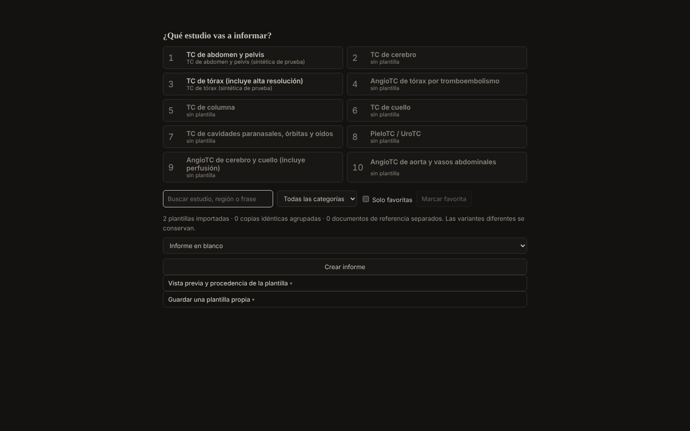
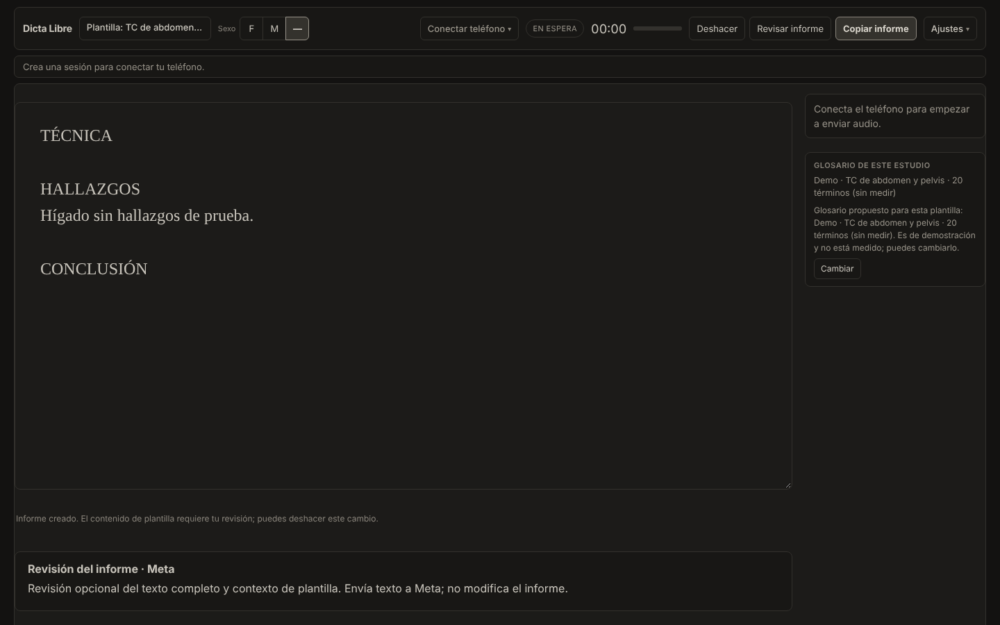
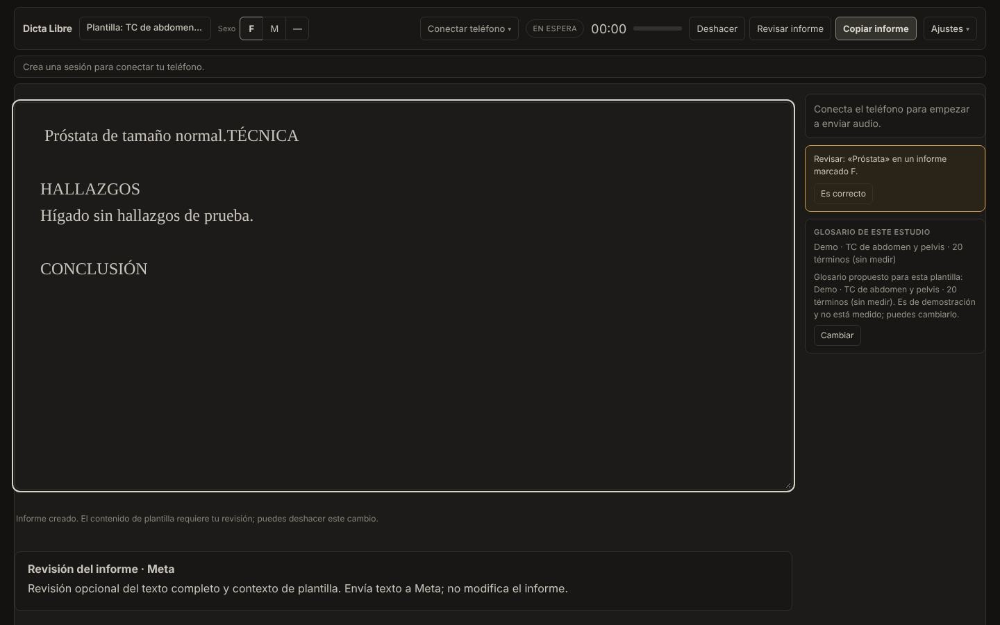
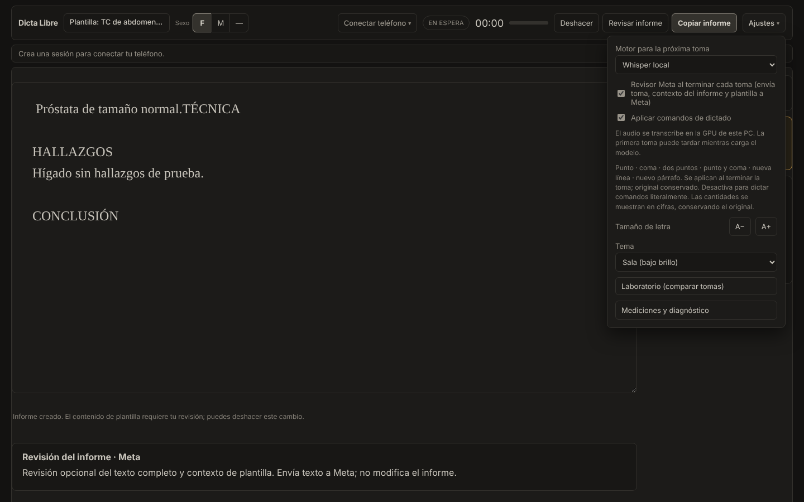
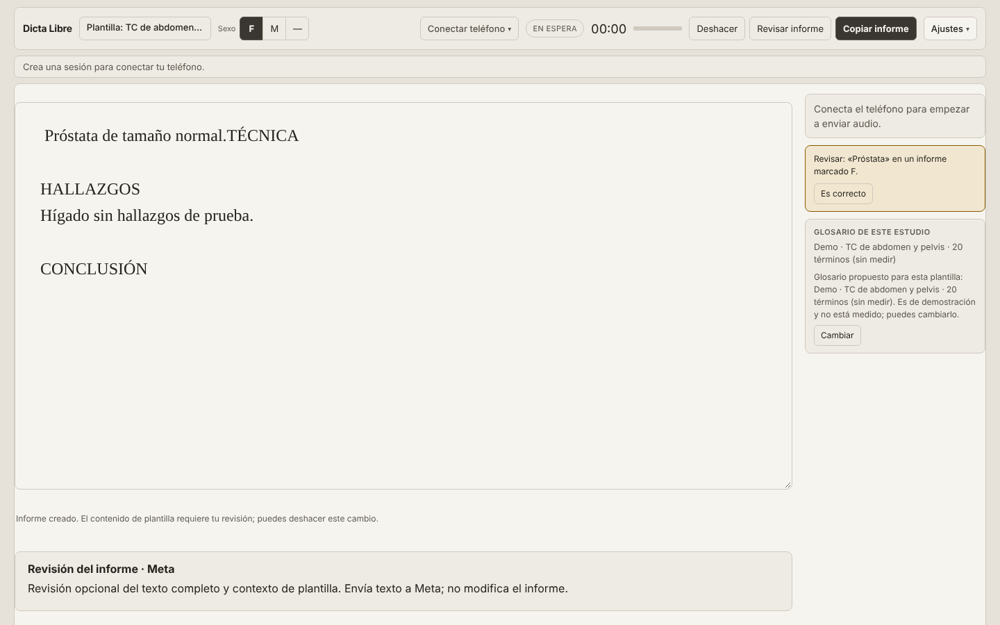

# Diseño final del MVP de /live («Hoja clínica», propuesta B v3)

**Decisión del responsable (2-nov-2026):** este es el diseño del MVP de `/live`, hasta que se agregue alguna otra función. Cambios posteriores a la interfaz se documentan aquí.

Este documento distingue lo **implementado y comprobado** de lo **pendiente**. No hay validación clínica ni de usabilidad con radiólogos: lo comprobado es el funcionamiento técnico en Chromium con material sintético.

## Qué se ve

*Sin plantilla ni texto, el selector ocupa la pantalla con los 10 exámenes más solicitados de la demo. Las plantillas de esta captura son sintéticas.*

*Tema «sala» (por defecto). Barra del estudio arriba, hoja del informe al centro y notas al margen.*

 

*Tema «día»: papel cálido, no blanco. Se activa solo desde Ajustes y se recuerda en este navegador.*

## Implementado

- **Selector de plantilla de un solo uso.** Si no hay plantilla ni texto, se abre a pantalla completa con «¿Qué estudio vas a informar?». Cada examen aplica la primera plantilla que le corresponde; sin plantilla queda desactivado y lo dice. Tras aplicar una, el panel se cierra y la barra muestra «Plantilla: … · cambiar». Con texto propio, reemplazar pide confirmación y se puede deshacer.
- **Barra del estudio** (fija arriba, una fila a 1366, 1440 y 1920 px): plantilla · sexo F/M/— · conexión del teléfono · estado, tiempo y nivel del dictado · Deshacer · Revisar informe · Copiar informe · Ajustes. El recorrido sigue terminando en copiar y pegar al RIS.
- **Sexo F/M/—** como botones; activa la revisión **local** de órganos del otro sexo (no se envía a Meta). El aviso aparece como nota, no cambia el texto ni bloquea la copia.
- **Notas al margen:** estado del dictado, avisos de sexo y «Glosario de este estudio» con botón «Cambiar» (los glosarios de demostración siguen marcados «sin medir»).
- **Ajustes:** motor, cierre de toma, Revisor Meta, comandos, glosario, tamaño de letra, tema (sala/día), laboratorio y «Mediciones y diagnóstico».
- **Paleta y tipografía** «Hoja clínica» v2.1 en `apps/desktop/live.css`, servida solo a `/live`. La página del teléfono y el relay no cambian.
- **A1 corregido** (prerrequisito del diseño): una sesión nueva del teléfono cancela solo las tomas pendientes; el informe se conserva, también tras «Reiniciar sesión y limpiar pantalla». Ese botón ya no vacía el informe; queda como decisión de producto si debe haber una acción explícita «Informe en blanco».
- Los controles existentes se **reubican**, no se reescriben: captura, transporte y reconocimiento no cambian.

## Comprobado

- `pnpm check`, 101 pruebas Node (una nueva: `/live.css` se sirve con tema sala por defecto y día explícito) y 5 de Python.
- Recorrido en Chromium con el laboratorio real y plantillas sintéticas (`propuesta-ui/mvp/verificacion/`): selector, aplicar plantilla, persistencia tras recargar, sexo con aviso, Ajustes, tema día, A1, sin errores de página ni desborde horizontal a 1366, 1440 y 1920 px.

## Pendiente o no comprobado

- **Sesión real con el S25 y grabación**: el recorrido no incluyó teléfono ni audio. Falta ver el estado «grabando» (rojo apagado) en vivo.
- **Plantillas reales (PUC)**: no se probaron aquí; la lista rápida depende de que sus nombres sean reconocidos por `examForTemplate`.
- **Fuentes Source Serif 4 y Public Sans** no están alojadas: hoy se ve la alternativa (Georgia / Segoe UI). Hay que alojarlas en local (licencia OFL).
- **Contrastes** calculados con la fórmula WCAG (`docs/propuesta-ui/contraste.py`), sin medir sobre los colores computados ni en la sala real. Sin auditoría de teclado ni de lector de pantalla.
- **Pantallas angostas**: bajo 1100 px las notas pasan debajo del informe y la barra puede ocupar dos filas; no se probó en tabletas.
- **Página del teléfono** sin rediseñar (el pedido fue `/live`).
- Sugerencias de ortografía o redacción por IA y el filtro A3: aplazados por el responsable.
