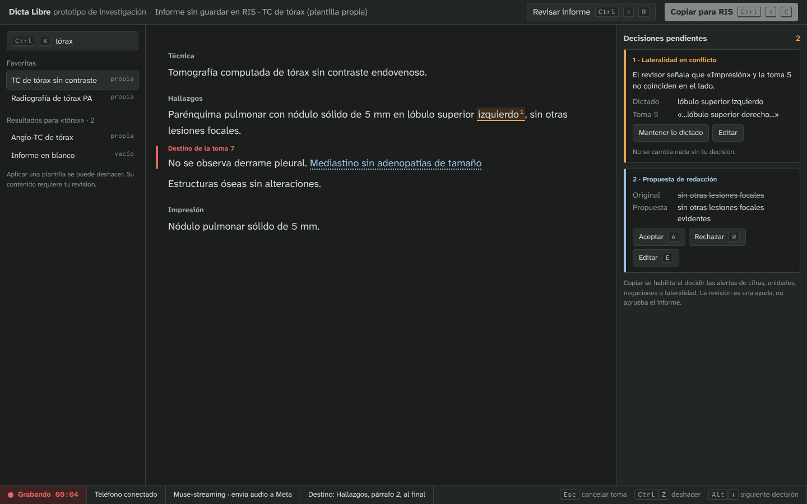
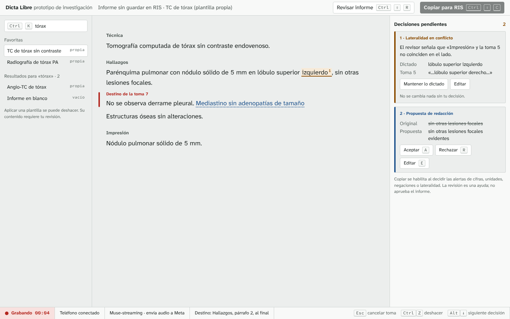
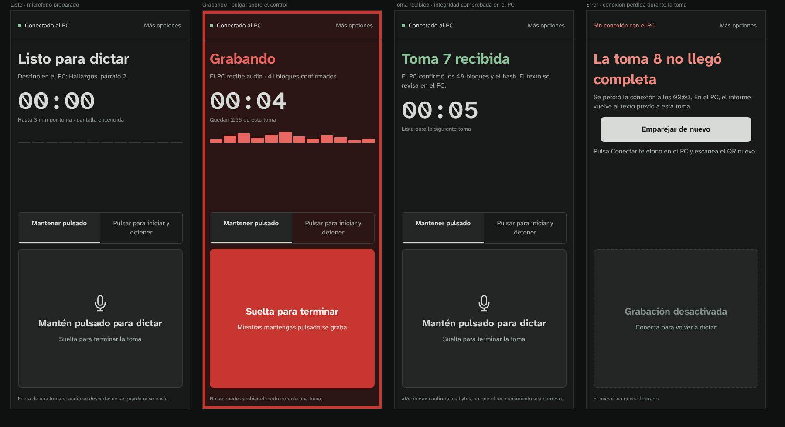
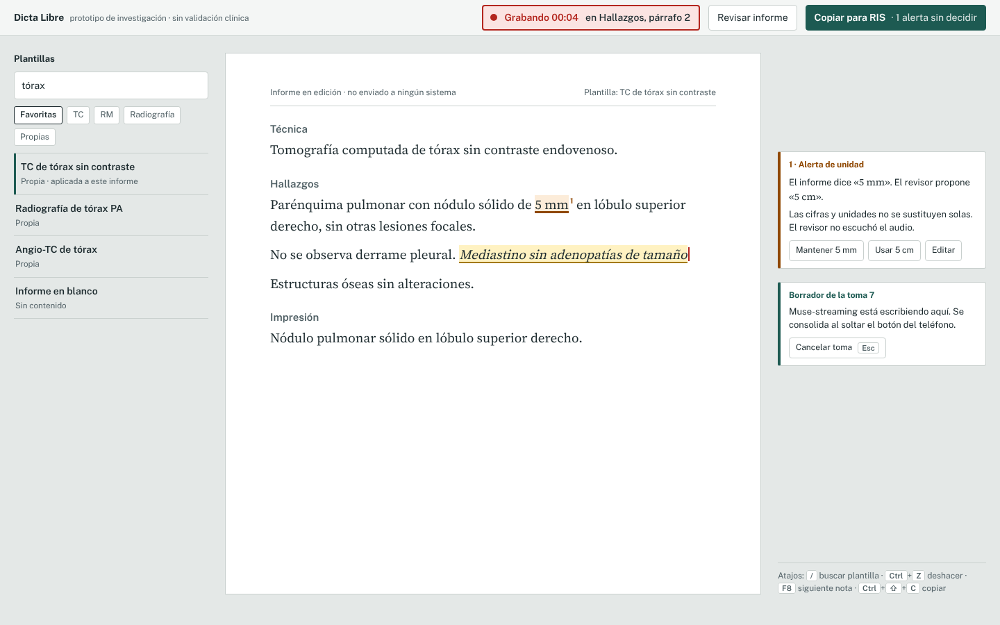
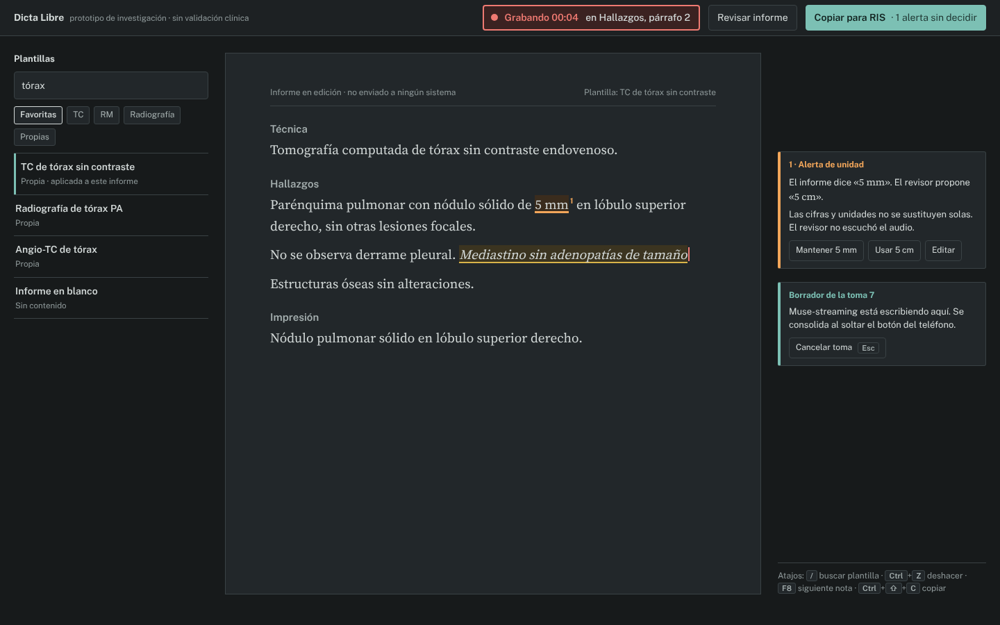
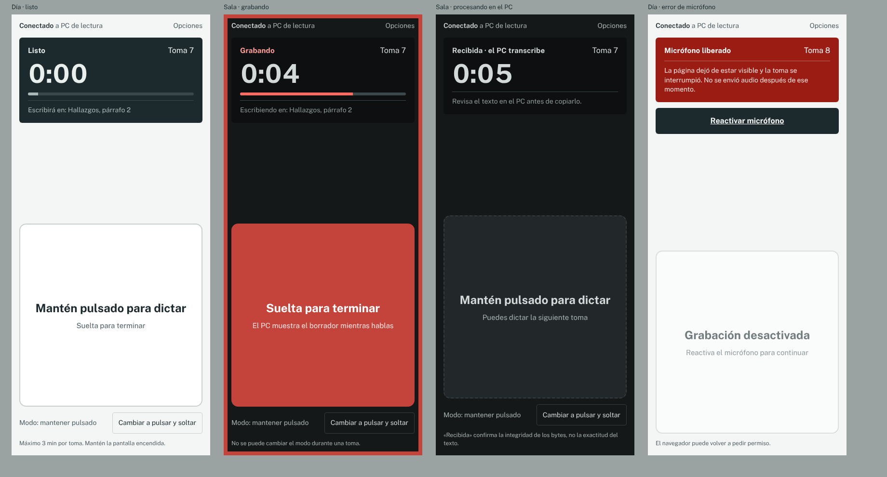

# Propuesta de interfaz · auditoría UI/UX y dos direcciones de diseño

**Fecha:** 2 de noviembre de 2026 (America/Santiago).
**Código observado:** rama `claude/dazzling-hamilton-k0apsq` sobre `654bed8`. Las capturas del estado actual corresponden a ese código servido en local, en la nube, sin teléfono físico.
**Naturaleza:** es una propuesta. **Nada de esto está implementado.** Las maquetas de `docs/propuesta-ui/` son HTML estático con texto sintético. No se conectan al relay, al laboratorio ni a ningún motor de reconocimiento.

## 0. Encargo, en una nota

- **Usuario:** médico radiólogo. Informa en computador, muchas veces en una sala de lectura con poca luz y con prisa. Está acostumbrado a dictáfonos. Usa el teléfono como micrófono, con una mano.
- **Lo que debe transmitir:** una herramienta profesional y sobria. No debe parecer una app genérica hecha por IA.
- **Recorrido fijo:** el recorrido termina en **copiar y pegar al RIS**. Esta propuesta no agrega integración con RIS/PACS ni la insinúa.
- **Restricciones:** el plazo del hackathon es el 4-nov a las 23:00. No se hacen refactors grandes ni se cambia el comportamiento de captura, transporte o reconocimiento sin pruebas y sin aprobación. Los textos van en español de Chile.
- **Supuestos (no confirmados por el responsable):**
  1. En la sala de lectura el PC es el monitor de informes, no el de diagnóstico.
  2. El teléfono queda sobre la mesa o en la mano no dominante.
  3. El médico mira el PC mientras dicta, no el teléfono.

## 1. Auditoría del estado actual

Ver la sección 1 completa más abajo («Estado actual: hallazgos»), con capturas en `docs/propuesta-ui/actual/`.

## 2. Principios comunes a ambas direcciones

Estos principios valen para cualquier dirección que se elija:

1. **El estado del dictado nunca es ambiguo.** Cada estado tiene a la vez un texto, una forma y un color. El color nunca es la única señal (WCAG 1.4.1). Los mensajes de estado se anuncian con `role="status"`. Los errores y el inicio de una grabación usan `aria-live="assertive"`.
2. **No hay éxito falso.**
   - «Recibida» significa que el PC verificó la secuencia y el hash. No dice nada de la exactitud del texto.
   - «Copiado» solo se muestra si `navigator.clipboard.writeText` resolvió.
   - «Revisado» no equivale a «aprobado».
3. **El destino del dictado está siempre a la vista** en el PC: sección, párrafo y si es cursor o selección. Hoy el destino queda fijado al iniciar la toma. La propuesta solo lo hace visible.
4. **Las alertas sensibles exigen una decisión.** Una alerta de cifra, unidad, negación o lateralidad no tiene un «aceptar» genérico. Las acciones nombran el resultado: «Mantener 5 mm» o «Usar 5 cm». Ver la §5.
5. **Sin decoración.** Sin degradados, glassmorphism, sombras difusas, emojis ni íconos ornamentales. El único ícono es el del micrófono, y solo cuando aporta. Radios pequeños, de 3 a 6 px; en el móvil, de 10 a 14 px en el control principal, para que se lea como una tecla.
6. **Los textos describen, no animan.** Nada de «¡Listo!» ni «¡Genial!». Los errores dicen qué pasó y qué hacer: «Pulsa Conectar teléfono en el PC y escanea el QR nuevo».
7. **Las fuentes se alojan en local** (licencia OFL, registrada en THIRD_PARTY.md). No se cargan desde Google en el producto, en línea con AGENTS.md: no se agregan servicios externos por defecto. Las maquetas usan Google Fonts solo para poder verse.
8. **Honestidad.**
   - La barra superior dice «prototipo de investigación», y en B además «sin validación clínica».
   - Se indica qué motor procesa y si envía audio o texto a Meta. Esto ya existe en el laboratorio y falta en /live.

## 3. Dirección A · «Sala de lectura»

**Idea:** una consola oscura y densa, pensada para usar con teclado, del tipo que el radiólogo ya conoce de las estaciones PACS. El estado vive en una barra inferior fija, como la barra de estado de un visor. Las decisiones pendientes forman una cola a la derecha.





Fuentes: `propuesta-ui/a-sala-escritorio.html` y `propuesta-ui/a-sala-movil.html`.

### Tipografía

| Rol | Fuente | Tamaño / interlínea | Motivo |
| --- | --- | --- | --- |
| Interfaz e informe | Atkinson Hyperlegible Next (400/500/700) | Informe 18/29 px; UI 15/22; etiquetas 12–13 | La diseñó el Braille Institute para distinguir caracteres confundibles (1/l/I, 0/O, 5/S). En un informe con medidas eso importa. |
| Tiempos, códigos y atajos | Atkinson Hyperlegible Mono (400/600) | Temporizador del móvil 56 px | Cifras de ancho fijo para que el temporizador no «salte». |

Las cifras del informe usan `font-variant-numeric: tabular-nums lining-nums`. La medida es de 72 caracteres como máximo.

### Paleta

| Token | Lectura (oscuro, por defecto) | Día | Uso |
| --- | --- | --- | --- |
| fondo | `#1b1e1d` | `#eceeed` | Grafito neutro, no negro puro: reduce el halo alrededor del texto. |
| superficie | `#222625` | `#f8f9f8` | Paneles laterales y barras. |
| línea | `#3a403e` | `#cdd2d0` | Divisores estructurales. |
| texto | `#d5dad6` (11,86:1 sobre fondo) | `#1d2422` (13,57:1) | Texto del informe; sin blanco puro, para no deslumbrar. |
| texto-2 | `#a3aca7` (7,21:1) | `#4d5753` |
| texto-3 | `#8a948f` (5,37:1 sobre fondo; 4,89:1 sobre superficie) | `#5f6965` (4,88:1) | Notas y etiquetas. | Secundario. |
| grabando | `#e8665f` (5,20:1) | `#b3261e` (5,24:1 sobre `#f8e1df`) | Solo para la grabación activa. |
| borrador | `#9cc0e6` (8,88:1) + subrayado punteado | `#24578f` (7,02:1) | Texto provisional del streaming. |
| alerta | `#f0a74e` sobre `#3a2d1c` (6,58:1) | `#8a4b00` sobre `#f7ead8` (5,74:1) | Cifras, unidades, negación y lateralidad. |
| foco | `#ffd27a` | `#0b57d0` | Anillo de foco de 2 px. |

Los contrastes se calcularon con la fórmula de luminancia relativa de WCAG 2.x sobre los hex declarados; script reproducible en `docs/propuesta-ui/contraste.py`. Son valores de diseño. Falta medirlos en pantalla con antialiasing y en el S25 real. Al calcularlos, `texto-3` (#828c87, 4,41:1 sobre superficie) no llegaba a AA y se corrigió a #8a948f. **Modo de bajo deslumbramiento:** es el tema por defecto. Tiene luminancia media baja, sin superficies grandes claras, y el único color saturado aparece cuando se graba.

### Jerarquía (escritorio, 1440×900)

```
┌──────────────────────────── barra superior 44 px ─────────────────────────────┐
│ Dicta Libre · prototipo   Informe · plantilla     [Revisar informe] [Copiar]  │
├──────────────┬───────────────────────────────────────────┬───────────────────┤
│ Plantillas   │                 Informe                   │ Decisiones (n)    │
│ Ctrl+K       │       72 caracteres, 18 px, izquierda     │ cola ordenada     │
│ favoritas    │   ▌ destino de la toma marcado en margen  │ alertas primero   │
│ resultados   │                                           │ luego propuestas  │
├──────────────┴───────────────────────────────────────────┴───────────────────┤
│ ● Grabando 00:04 │ Teléfono conectado │ Motor · envía audio a Meta │ Destino │ atajos │
└─────────────────────────────── barra de estado 34 px ────────────────────────┘
```

### Móvil (412×915, S25 Ultra)

- El control principal mide **≈ 380×320 px** y está en el tercio inferior, al alcance del pulgar. Es un rectángulo de esquinas suaves con un texto que dice exactamente lo que pasa: «Mantén pulsado para dictar» y luego «Suelta para terminar».
- **Mientras graba cambia la pantalla completa:**
  - el fondo pasa a rojo oscuro;
  - aparece un borde interior de 6 px;
  - el título dice «Grabando» en grande;
  - corren el temporizador y el tiempo restante («Quedan 2:56»);
  - el medidor de nivel se tiñe.

  La señal no depende de un punto rojo pequeño.
- El modo (mantener pulsado o pulsar para iniciar y detener) es un selector visible de dos opciones, bloqueado durante la toma. No hay gestos ocultos.
- Las opciones secundarias (tono sintético, vibración, exportar diagnóstico, finalizar sesión) pasan a «Más opciones». Hoy están todas en la pantalla principal.

## 4. Dirección B · «Hoja de informe»

**Idea:** el informe es una hoja. El texto va en serif, como el documento final, centrado sobre una mesa neutra. Las alertas y propuestas son notas al margen ancladas al párrafo, como los comentarios de un procesador de texto. En el móvil, la metáfora es la de un **dictáfono**: un visor fijo arriba y una tecla grande abajo.





Fuentes: `propuesta-ui/b-hoja-escritorio.html` y `propuesta-ui/b-hoja-movil.html`.

### Tipografía

| Rol | Fuente | Tamaño / interlínea | Motivo |
| --- | --- | --- | --- |
| Texto del informe | Source Serif 4, con ejes ópticos (400/600) | 19/31 px, 64 caracteres | Separa visualmente el documento que se copiará de los controles. Es una serif de pantalla con cifras alineadas y tabulares. |
| Interfaz | Public Sans (400–700) | 14/20; botones 14; visor del móvil 54 px | Sans neutra con buena distinción de cifras, distinta de la serif. |

### Paleta

| Token | Día (por defecto) | Sala (bajo deslumbramiento) | Uso |
| --- | --- | --- | --- |
| mesa | `#e4e8e7` | `#171a1b` | Fondo alrededor de la hoja. |
| hoja | `#ffffff` | `#22272a` | Superficie del informe. |
| tinta | `#1c2a2e` (14,79:1 sobre hoja) | `#d3d9d8` (10,55:1) | Texto. |
| tinta-3 | `#55646a` (4,97:1 sobre mesa) | `#8e9899` (5,92:1) | Notas; se corrigió desde #5d6b70 (4,47:1, no cumplía). |
| institucional | `#1d5a52` (blanco encima 7,96:1) | `#7cc0b4` (texto `#10201d` encima 8,07:1) | Acción final («Copiar para RIS») y la plantilla aplicada. Continúa el verde actual (`#164c3b`). |
| grabando | `#b3261e` (5,38:1 sobre `#fbe4e2`); tecla móvil blanco sobre rojo 6,54:1 | `#ef7a72` (5,36:1); tecla móvil `#c4433b` con blanco 4,98:1 (se corrigió desde #d9534b, 3,97:1) | Indicador de destino en la barra superior mientras se graba. |
| borrador | fondo `#fff2c2` + subrayado `#a37a00`, cursiva | `#3b3420` + `#d9b44a` | Como el resaltador de una transcriptora. |
| alerta | `#8f4700` sobre `#fcecd9` | `#f2a65a` sobre `#3a2c1d` | Notas al margen y subrayado grueso. |

### Jerarquía

```
┌ barra 52 px: nombre · prototipo · sin validación ── [● Grabando 00:04 en Hallazgos ¶2] [Revisar] [Copiar para RIS · 1 alerta] ┐
├──────────────┬──────────────── hoja (780 px) ────────────────┬──────────── margen ────────────┐
│ Plantillas   │ Informe en edición · no enviado a ningún sistema│                                │
│ [buscar  / ] │ Técnica                                        │                                │
│ filtros      │ Hallazgos ……… 5 mm¹ ………                         │ ┌ 1 · Alerta de unidad ───┐   │
│ lista        │ ……… borrador en cursiva ▌                      │ │ Mantener 5 mm | Usar 5 cm│   │
│              │ Impresión                                      │ └──────────────────────────┘   │
└──────────────┴────────────────────────────────────────────────┴────────────────────────────────┘
```

### Móvil

- **Visor:** un bloque oscuro fijo arriba, incluso en el tema día, para que el estado se lea siempre en el mismo lugar. Muestra:
  - el estado (Listo, Grabando, Recibida · el PC transcribe, Micrófono liberado);
  - el número de toma;
  - el tiempo en 54 px;
  - el nivel;
  - el destino en el PC.
- **Tecla:** ocupa ≈ 380×380 px en la mitad inferior. Al grabar se vuelve roja y la pantalla gana un borde rojo de 8 px.
- **Modo:** un texto («Modo: mantener pulsado») y un botón explícito «Cambiar a pulsar y soltar», de 44 px de alto como mínimo.

## 5. Estados del dictado y alertas sensibles (ambas direcciones)

| Estado | Qué lo dispara hoy (código) | Móvil | Escritorio | Anuncio |
| --- | --- | --- | --- | --- |
| **Listo** | Micrófono preparado y emparejado | «Listo para dictar», control neutro | Barra o indicador gris: «Teléfono conectado» | `status` |
| **Grabando** | `start` confirmado por la captura | Pantalla completa roja, temporizador y tiempo restante | Indicador rojo con tiempo y destino; margen rojo en el párrafo de destino | `assertive` una vez al iniciar |
| **Procesando** | `end` enviado, a la espera de verificación y luego del motor | «Recibida · el PC transcribe», solo después del `verified` del PC | Borrador en cursiva o color de borrador; «Esperando el final de Muse-streaming» | `status` |
| **Borrador** | Parciales de Muse-streaming | — (no hace falta en el teléfono) | Texto provisional en el destino con estilo de borrador; no se puede copiar ni editar | Sin anuncio por parcial (sería ruido para el lector de pantalla); un anuncio al consolidar |
| **Consolidado** | Final de la toma insertado | «Toma n recibida» | El texto pasa a estilo normal; «Toma incorporada. Puedes deshacer (Ctrl+Z)». | `status` |
| **Error** | Corte, hash incorrecto, fallo del motor, cancelación | Título rojo con la causa concreta y **una** acción de recuperación | Mensaje en la barra con la causa y la acción; el informe restaurado se indica de forma explícita | `assertive` / `role="alert"` |

### Alertas sensibles (cifras, unidades, negaciones, lateralidad)

Hoy el revisor ya convierte estos cambios en alertas sin sustitución directa (META_REVIEW.md). La propuesta solo cambia la presentación:

1. **En el texto**, el fragmento afectado lleva un subrayado grueso de color alerta y un superíndice numerado (¹). Ese número también es la etiqueta de la nota, así que no se depende del color.
2. **En el panel o margen**, la nota muestra el tipo («Alerta de unidad», «Lateralidad en conflicto», «Negación»), el texto actual y el propuesto, y botones que nombran el resultado: «Mantener 5 mm» o «Usar 5 cm». No hay un «Aceptar» genérico. Agrega una frase fija: «El revisor no escuchó el audio».
3. **Al copiar con alertas sin decidir**, el botón muestra «Copiar para RIS · 1 alerta sin decidir». Si es bloqueante o solo una advertencia es **decisión de producto pendiente** (ver la §8). Hoy se ofrece «revisar o copiar sin revisar».
4. **La navegación** entre decisiones se hace con teclado: Alt+↓ en A y F8 en B. El foco salta del fragmento a la nota y vuelve.

## 6. Accesibilidad (objetivo para ambas)

- **Contraste:** el texto normal debe alcanzar ≥ 4,5:1 y los elementos de UI y bordes de foco ≥ 3:1 (WCAG 2.2 AA). Los valores de la §3 y la §4 se calcularon desde los hex con la fórmula WCAG; hay que repetir el cálculo al implementar, sobre los colores computados por el navegador.
- **Tamaño táctil:** en el móvil, todo control mide ≥ 44×44 px y el principal ≥ 300 px de alto. En escritorio, ≥ 32 px de alto.
- **Teclado:**
  - todo es alcanzable con Tab;
  - el foco es visible (2 px, color de foco) y no queda oculto por la barra fija (WCAG 2.4.11);
  - los atajos se muestran en pantalla, al lado de su acción;
  - ningún atajo de una sola letra actúa mientras el foco está en el editor (WCAG 2.1.4). Los de una letra (A, R, E) solo valen con el foco en la nota.
- **Lector de pantalla:**
  - el editor es un `textbox` multilínea con nombre;
  - el borrador se marca con `aria-describedby` («texto provisional»);
  - las notas son `region` con título;
  - se usa un único `aria-live` para el estado, y no uno por tarjeta.
- **Movimiento:** no hay animaciones decorativas. El medidor de nivel respeta `prefers-reduced-motion` y en ese caso muestra un valor estático por segundo.
- **Zoom:** el diseño se mantiene al 200 % sin desplazamiento horizontal. En el móvil se verifica con el tamaño de fuente del sistema en «grande».

## 7. Comparación y recomendación

| Criterio | A · Sala de lectura | B · Hoja de informe |
| --- | --- | --- |
| Sala con poca luz | Oscuro por defecto; muy bueno | Requiere elegir el tema «sala»; bueno |
| Ver el destino sin ambigüedad | Barra de estado fija y margen rojo | Indicador destacado en la barra superior y cursor rojo |
| Revisar alertas | Cola ordenada y rápida con teclado | Notas en contexto, junto al texto |
| Parecido con el texto que llega al RIS | Medio (sans) | Alto (serif, hoja) |
| Costo de implementación sobre el código actual | Medio: tres zonas y una barra de estado | Medio-alto: alinear las notas al párrafo exige medir posiciones |
| Riesgo antes del 4-nov | Ninguna de las dos debe implementarse completa antes del plazo (ver la §9) | Igual |

**Recomendación del equipo:** usar la **A para escritorio**, porque es oscura por defecto, rápida con teclado y la cola de decisiones es más simple de implementar que las notas ancladas. Para el móvil, usar el **visor fijo de la B**: el estado siempre en el mismo lugar es lo que más se parece a un dictáfono. La decisión es del responsable.

## 8. Decisiones de producto abiertas (se preguntarán una a la vez)

1. ¿Las alertas sensibles sin decidir **bloquean** la copia, o solo **advierten** (como hoy)?
2. ¿Debe el teléfono mostrar el **destino** del dictado («Escribirá en: Hallazgos, párrafo 2»)? Requiere enviar ese dato del PC al teléfono, es decir, un cambio de protocolo.
3. ¿Hace falta un **atajo de teclado para cancelar la toma** desde el PC (Esc)? Hoy la cancelación es un botón de la tarjeta de la toma.

## 9. Qué es seguro antes del plazo y qué no

| Cambio | Toca | ¿Antes del 4-nov? |
| --- | --- | --- |
| Corregir textos engañosos o desactualizados (ver «Estado actual») | Solo HTML/textos | Sí, con revisión |
| Tokens de color y tema oscuro por `prefers-color-scheme` en `style.css`, sin cambiar la estructura | CSS | Sí, si se capturan antes y después y se mide el contraste |
| Mover las opciones secundarias del móvil a un `<details>` «Más opciones» | HTML/CSS del móvil | Sí, con la prueba física del S25 pendiente marcada |
| Agrandar el control principal y el estado de grabación a pantalla completa | CSS del móvil | Sí, si no se toca `mobile.js` |
| Barra de estado y cola de decisiones en el escritorio | `live.js`, `report-editor.js`, `review-ui.js` | **No**: después del hackathon |
| Destino visible en el teléfono | Protocolo | **No**: requiere aprobación y pruebas |
| Bloquear la copia con alertas pendientes | Comportamiento | Solo si el responsable lo decide; incluye una prueba en `report-review.test.mjs` |
| Fuentes alojadas en local | Recursos y THIRD_PARTY | Después; no aporta a la demo |

## 10. Cómo medir si la propuesta mejora algo

Esto se registrará en EXPERIMENTS.md antes de comparar. Por ahora no hay mediciones; todo es `null`.

- **Hipótesis:** con la propuesta baja el tiempo para localizar el destino y decidir una alerta, sin errores de inserción.
- **Métricas:**
  - tiempo desde la indicación «decide la alerta 1» hasta el clic de decisión, en ms;
  - errores de decisión, en conteo;
  - clics y desplazamientos hasta el editor, en conteo;
  - tiempo desde que se suelta el botón del móvil hasta el texto consolidado visible, en ms (ya instrumentado parcialmente).
- **Condiciones:**
  - mismo PC, navegador, zoom (1366×768 y 1920×1080) y plantilla sintética;
  - las mismas tres alertas sintéticas;
  - orden alternado A/actual;
  - cinco tareas por variante.
- **Criterio de aceptación:**
  - cero pérdidas o cambios fuera de la selección;
  - cero saltos de foco;
  - contraste AA medido.

  La reducción mínima de tiempo la define el responsable. Se conservan los resultados favorables y los desfavorables.
